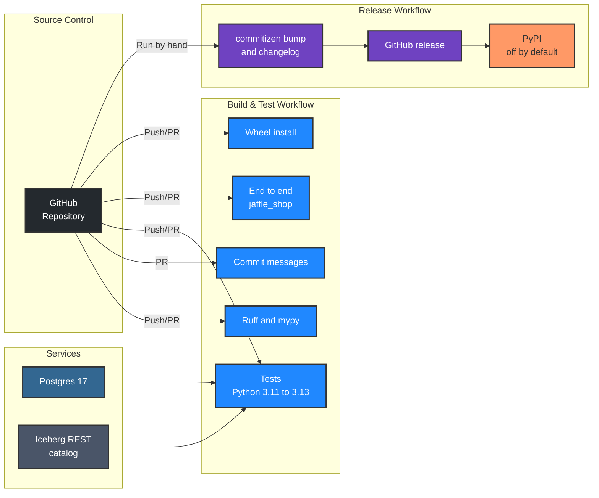

<p align="center">
<a target="_blank" href="https://kodexlabs.io/"></a>
</p>
<p align="center">
<a href="https://github.com/kodexlabsio/kerplunk/actions/workflows/build-and-test.yml"></a>&nbsp;<a href="https://github.com/kodexlabsio/kerplunk/actions/workflows/release.yml"></a>&nbsp;<a href="./LICENSE"></a>&nbsp;
<br />
<a href="https://kodexlabs.io/" target="_blank">Kodex Labs</a> Ltd.
</p>

kerplunk turns a data stack into a graph that coding agents can query: dbt models, sources, seeds, tests and exposures; warehouse and Iceberg tables with their columns; Airflow DAGs and tasks; and column-level lineage parsed from the SQL that connects them. One command builds it locally. Agents then ask what a change will break, where a value comes from, or how two tables connect, from the command line, a `/kerplunk` skill in Claude Code and Cursor, or an MCP server.


## Quick Start

```bash
uv tool install kerplunk        # until it is on PyPI: uv tool install git+https://github.com/kodexlabsio/kerplunk
cd your-data-repo
kerplunk build .                # writes kerplunk-out/graph.json, REPORT.md and graph.html
kerplunk impact orders.amount   # everything downstream of a column
kerplunk install                # adds the /kerplunk skill to Claude Code and Cursor
```

To try it on the bundled example (jaffle_shop on DuckDB, with an Airflow DAG), from a clone of this repository:

```bash
uv sync
uv run .kodex/scripts/prepare_example.py      # builds the example's DuckDB warehouse with dbt
uv run kerplunk build examples/jaffle_shop    # about a second
uv run kerplunk impact stg_payments.amount --path examples/jaffle_shop
```

`kerplunk build` needs no configuration: it finds dbt projects, Airflow DAG files, SQL files, DuckDB files and the warehouse each dbt profile points at. If a dbt project's `target/manifest.json` is missing or older than the project files and `dbt` is on `PATH`, it runs `dbt docs generate` first.

## Supported Inputs

| Input | What kerplunk reads | Status |
|-------|---------------------|--------|
| **dbt** | `target/manifest.json` and `catalog.json`: models, seeds, snapshots, sources, tests (attached to columns), exposures, descriptions, column types. Compiled SQL for lineage; `ref()` and `source()` are resolved from the manifest when only raw SQL is available | v0 |
| **SQL** | Column-level lineage with [sqlglot](https://github.com/tobymao/sqlglot) for dbt models, warehouse views, Airflow SQL and standalone `.sql` files (`CREATE ... AS`, `INSERT ... SELECT`, `MERGE`, `UPDATE`, `DELETE`, `COPY`). Dialect from the dbt adapter or configuration | v0 |
| **Airflow** | DAG files parsed statically (never imported): `with DAG`, assigned DAGs, `@dag`, TaskFlow, TaskGroups, `>>`, `<<`, `chain`, `cross_downstream`. Per task: dbt commands (BashOperator, `@task.bash`, Cosmos, dbt operators) resolved to models with dbt's selection syntax; SQL inline or from files; target and source tables; inlet and outlet assets | v0 |
| **DuckDB** | Tables, views, columns, types, comments and view definitions, read only | v0 |
| **Postgres** | Tables, views, materialised views, partitioned tables, columns, types, comments and view definitions, read only | v0 |
| **Iceberg** | Any PyIceberg catalog, REST included: namespaces, tables, columns (nested struct fields as `parent.child`), field ids, identifier fields, partitioning, current snapshot. Metadata only; no data files are read | v0 |
| **Dagster** | Assets and jobs | v1 |
| **Snowflake, BigQuery, Databricks** | Warehouse metadata, behind optional extras. Their SQL dialects already work for lineage | v1 |

## Commands

| Command | Purpose |
|---------|---------|
| `kerplunk build [path] [--update]` | Build `kerplunk-out/`. `--update` reuses cached analyses of anything unchanged (keyed by file hashes, compiled SQL, manifest checksums and the upstream columns each model sees). `--no-dbt`, `--no-warehouse`, `--dialect`, `--out` |
| `kerplunk impact <table.column>` | Everything downstream: derived columns, relations, models that join, filter or group on it, tests, exposures and the DAG tasks that run them |
| `kerplunk trace <table.column>` | Everything upstream, each step marked `direct` (passed through or renamed) or `transformed` |
| `kerplunk path <a> <b>` | Shortest connection between two tables or columns |
| `kerplunk search <words>` | Find nodes by name or description, optionally `--kind model` |
| `kerplunk describe <name>` | Columns, types, descriptions, tests and neighbours of one node; for a task, what it runs and its neighbours in the DAG |
| `kerplunk query "<question>"` | Free-text question: ranks nodes by its words and returns them with their connections, plus impact or lineage when the question asks for it. There is no language model in kerplunk; the agent reads the result |
| `kerplunk install` | Register the `/kerplunk` skill (see Agent Integration) |
| `kerplunk mcp` | Run the MCP server on stdio |

Tables and columns can be named as `orders`, `main.orders`, `orders.amount`, `jaffle_shop.main.orders.amount` or by dbt unique id. Query commands find `kerplunk-out` in the current directory or above it, and accept `--json`.

## Outputs

| File | Contents |
|------|----------|
| `graph.json` | Nodes (`source`, `table`, `column`, `model`, `seed`, `snapshot`, `dag`, `task`, `test`, `exposure`) and edges (below), with descriptions, types, file paths and the inputs each came from |
| `REPORT.md` | Summary and coverage, the most used columns, orphans, untested models, columns with no lineage, columns documented in dbt but missing from the warehouse, and warnings |
| `graph.html` | A single offline file: relations and tasks in dependency order, search, a details panel and column lineage in both directions |

| Edge | Direction | Meaning |
|------|-----------|---------|
| `contains` | relation to column | The column belongs to the relation |
| `feeds` | upstream to downstream | Relation to relation, task to the table it writes, table to the task that reads it. With `role: reference`, a column the target uses in a JOIN, WHERE, GROUP BY, HAVING or QUALIFY |
| `derived_from` | column to the column it comes from | Column-level lineage, with `transform: direct` or `transformed` |
| `runs` | DAG to task, task to dbt node | What a DAG or task executes |
| `precedes` | task to task | Airflow ordering |
| `tests` | test to relation or column | What a dbt test checks |


## Agent Integration

`kerplunk install` writes `~/.claude/skills/kerplunk/SKILL.md`. Claude Code and Cursor both read that location, so `/kerplunk what breaks if I change stg_payments.amount?` works in either. The skill tells the agent to keep the graph current with `kerplunk build --update`, to run `impact` before changing a model or column, and how to read the output. It pre-approves `kerplunk` shell commands for the turn it runs in.

| Option | Effect |
|--------|--------|
| `--agent claude\|cursor\|both` | `cursor` writes `~/.cursor/skills` instead. Default `both` |
| `--project <dir>` | Install into a repository (`.claude/skills`) rather than the home directory, so the team shares it |
| `--mcp` | With `--project`, also register `kerplunk mcp` in `.mcp.json` (Claude Code) and `.cursor/mcp.json` (Cursor), keeping any other servers |
| `--force` | Replace a skill that was edited by hand; otherwise a reinstall only replaces kerplunk's own earlier versions |

The MCP server exposes `impact`, `trace`, `search`, `describe` and `path`, returns structured results, and rereads `graph.json` when a build changes it.

## Configuration

Configuration is optional. Put it in `kerplunk.toml` at the project root, or under `[tool.kerplunk]` in `pyproject.toml`. `${VAR}` and `${VAR:-default}` read the environment, so credentials stay out of the file.

```toml
dialect = "postgres"              # default: the dbt adapter, then the first warehouse
default_catalog = "analytics"     # for unqualified tables in Airflow and SQL files
default_schema = "public"
exclude = ["scratch/**"]
out_dir = "kerplunk-out"

[dbt]
projects = ["transform"]          # default: every dbt_project.yml found
run = true                        # run `dbt docs generate` when artefacts are missing or stale

[airflow]
dags = ["orchestration/dags"]     # default: Python files that look like DAGs

[sql]
paths = ["sql/**/*.sql"]          # default: .sql files outside dbt folders and not used by DAGs

[[warehouse]]                     # setting any warehouse turns discovery off
type = "postgres"
dsn = "${WAREHOUSE_DSN}"
schemas = ["raw", "analytics"]

[[warehouse]]
type = "duckdb"
path = "data/local.duckdb"

[[warehouse]]
type = "iceberg"
name = "lake"                     # the catalogue name SQL uses, e.g. lake.sales.orders
uri = "http://localhost:8181"
namespaces = ["sales"]
[warehouse.properties]            # passed to pyiceberg.catalog.load_catalog
credential = "${ICEBERG_CREDENTIAL}"
```

## How Lineage Works

- kerplunk qualifies each statement against the columns it knows (from the dbt catalog, the warehouse, or the lineage of upstream models, processed in dependency order), so `SELECT *` expands. sqlglot then follows every output column through CTEs, subqueries, aliases, unions and window functions to physical columns.
- A path made only of column references and renames is `direct`; anything else (arithmetic, functions, aggregates, `CASE`, window functions) is `transformed`.
- Columns that change which rows a model returns, without being selected (join keys, filters, GROUP BY, HAVING, QUALIFY), are recorded as `feeds` edges with `role: reference`, traced through CTEs. Impact reports the relations that use them but does not then mark every downstream column, which would bury the answer.
- dbt models, warehouse tables with the same relation name, Airflow SQL targets and Iceberg tables merge into one node, so lineage crosses tools: a column computed in dbt, copied into a reporting table by an Airflow task, and used by a dashboard is one chain.

## Limitations

- Lineage is static. SQL built at runtime, Jinja that dbt has not compiled, Python models, stored procedures and UDF internals are not followed; each gap is listed under Warnings in `REPORT.md`.
- Without compiled SQL (no `dbt compile` or `docs generate`), kerplunk resolves `ref()` and `source()` itself and drops other Jinja, so macros that generate columns are missed.
- `SELECT *` over a relation whose columns kerplunk cannot learn is recorded as a same-name pass-through, and reported.
- Airflow parsing covers the common ways of writing DAGs. Task ids or SQL built in loops or from runtime values, dynamic task mapping over computed lists, and DAG factories are skipped with a warning. Selections by `--selector`, `state:`, `result:` and `source_status:` are not resolved.
- Identifiers are matched case-insensitively. Two relations whose names differ only by case are treated as one.
- `query` ranks by words, not meaning. It finds `customer_lifetime_value` from "lifetime value" but not from "how much a customer is worth"; the agent is expected to follow up with `search` or `describe`.
- Iceberg nested fields are listed as columns, but lineage does not yet go inside structs, lists or maps.

### Not Yet (v1)

- Dagster assets and jobs.
- Snowflake, BigQuery and Databricks metadata connectors as optional extras.
- Column-level lineage for dbt Python models and through UDFs.
- Lineage into nested Iceberg and struct fields.
- Incremental warehouse metadata (it is re-read on every build; it is fast for local warehouses but not for large remote ones).

## CI/CD

Build and Test runs on every push to `main` and on pull requests: Ruff and mypy, a commit message check on pull requests, the test suite on Python 3.11, 3.12 and 3.13 against Postgres and Iceberg REST catalog service containers, an end-to-end build of the jaffle_shop example that fails if it takes a minute or more, and an install of the built wheel with `uv tool install`. Create Release is run by hand: commitizen works out the next version from the Conventional Commits since the last tag, updates `pyproject.toml`, `src/kerplunk/__init__.py` and `CHANGELOG.md`, tags the release and publishes a GitHub release with the wheel and sdist. Publishing to PyPI is a separate job that stays off until the `PUBLISH_TO_PYPI` repository variable is `true` and a `pypi` environment with trusted publishing exists.



## Development

### Prerequisites

- [uv](https://docs.astral.sh/uv/) (it installs Python 3.12 for the project)
- Docker, for the Postgres and Iceberg integration tests
- [vhs](https://github.com/charmbracelet/vhs), only to re-record the demo GIFs

### Installation

1. **Clone the repository**
   ```bash
   git clone git@github.com:kodexlabsio/kerplunk.git
   cd kerplunk
   ```

2. **Install dependencies and the git hooks**
   ```bash
   uv sync
   uv run pre-commit install
   ```
   The hooks run Ruff and mypy before each commit, check the commit message, and run the tests before each push.

### Tests

```bash
uv run pytest                                   # Postgres and Iceberg REST tests skip without services
eval "$(.kodex/scripts/services.sh up)"         # start them in Docker and export their addresses
uv run pytest                                   # now everything runs
.kodex/scripts/services.sh down
```

The dev dependencies include dbt-core and dbt-duckdb, so the dbt and end-to-end tests build a copy of the example project for real. In CI, `KERPLUNK_REQUIRE_SERVICES=1` turns a missing service into a failure rather than a skip.

### Other Commands

- `uv run ruff check`, `uv run ruff format`, `uv run mypy`: lint, format and type check (strict)
- `uv run .kodex/scripts/prepare_example.py`: build the example warehouse
- `vhs .kodex/scripts/demo-cli.tape`: re-record `docs/demo-cli.gif`
- `vhs .kodex/scripts/demo-claude-code.tape`: record the same question through `/kerplunk` in Claude Code (needs Claude Code signed in)

### Commits

Commits follow [Conventional Commits](https://www.conventionalcommits.org/), checked by commitizen and by `.kodex/scripts/check_commit_message.py`, which applies the Kodex Labs rules: a fixed list of scopes, sentence-case subjects, lines of at most 100 characters, and no AI attribution lines. The scopes are `airflow`, `dbt`, `iceberg`, `sql`, `warehouse`, `build`, `graph`, `html`, `lineage`, `query`, `report`, `cli`, `mcp`, `skill`, `examples`, `readme`, `tests`, `ci`, `config`, `deps`, `deps-dev` and `release`.

### Repository Layout

| Path | Contents |
|------|----------|
| `src/kerplunk/graph.py` | Graph model, name resolution, impact, trace and path |
| `src/kerplunk/sql.py` | sqlglot column lineage |
| `src/kerplunk/dbt.py`, `airflow.py`, `warehouse.py` | Inputs |
| `src/kerplunk/config.py`, `build.py` | Configuration, discovery, the build and its cache |
| `src/kerplunk/query.py`, `report.py`, `html.py` | Questions over the graph, REPORT.md and graph.html |
| `src/kerplunk/cli.py`, `mcp_server.py`, `skill.py` | Interfaces |
| `examples/jaffle_shop` | dbt Labs' jaffle_shop_duckdb (Apache-2.0, see its NOTICE) with an Airflow DAG |
| `.kodex/scripts` | Project scripts: example preparation, test services, commit rules, demo tapes |

## Licence

MIT. See [LICENSE](LICENSE). The jaffle_shop example keeps its own Apache-2.0 licence.
