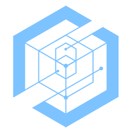
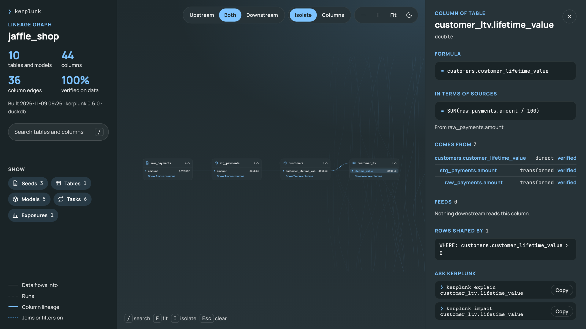
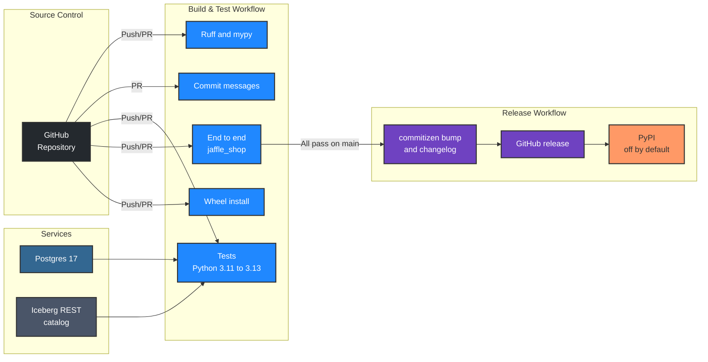

<p align="center">
<a target="_blank" href="https://kodexlabs.io/"></a>
</p>
<p align="center">
<a href="https://github.com/kodexlabsio/kerplunk/actions/workflows/build-and-test.yml"></a>&nbsp;<a href="https://github.com/kodexlabsio/kerplunk/actions/workflows/release.yml"></a>&nbsp;<a href="./LICENSE"></a>&nbsp;
<br />
<a href="https://kodexlabs.io/" target="_blank">Kodex Labs</a> Ltd.
</p>

kerplunk turns a data stack into a graph that coding agents can query: dbt models, sources, seeds, tests and exposures; warehouse and Iceberg tables with their columns; Airflow DAGs and tasks; and column-level lineage parsed from the SQL that connects them. One command builds it locally. Agents then ask what a change will break, where a value comes from, or how two tables connect, from the command line, a `/kerplunk` skill in Claude Code and Cursor, or an MCP server.

Two things set it apart from other lineage tools:

- **The lineage is tested against the data.** `kerplunk verify` perturbs each input column of each model (shifting, nulling and shuffling it with a fixed seed), reruns the SQL on a scratch copy and records which outputs actually change. On dbt Labs' jaffle-shop, every one of the 87 claimed column edges is confirmed, and every observed influence was predicted. See [How Much to Trust the Lineage](#how-much-to-trust-the-lineage).
- **It reviews changes before they merge.** `kerplunk diff` compares a branch with main column by column, ignoring formatting and renamed CTEs, and names the downstream models that a removed column will break. It can post the result as a pull request comment and fail the check.


## Quick Start

kerplunk is not on PyPI yet, so install it from GitHub with [uv](https://docs.astral.sh/uv/):

```bash
uv tool install git+https://github.com/kodexlabsio/kerplunk
```

Or run it without installing anything, each time:

```bash
uvx --from git+https://github.com/kodexlabsio/kerplunk kerplunk build
```

For a warehouse extra, name it in the requirement, for example
`uv tool install "kerplunk[snowflake] @ git+https://github.com/kodexlabsio/kerplunk"` (or `[bigquery]`, `[databricks]`, `[all]`).
To pin a release, add its tag: `git+https://github.com/kodexlabsio/kerplunk@v0.5.0`. Each [release](https://github.com/kodexlabsio/kerplunk/releases) also has the wheel attached.

Then, in a repository with dbt models, SQL, DAGs or a warehouse:

```bash
cd your-data-repo
kerplunk status                 # what kerplunk finds here, before building anything
kerplunk build                  # writes kerplunk-out/graph.json, REPORT.md and graph.html
kerplunk impact orders.amount   # everything downstream of a column
kerplunk open                   # the interactive graph in a browser
kerplunk install                # adds the /kerplunk skill to Claude Code and Cursor
```

To try it on the bundled example (jaffle_shop on DuckDB, with an Airflow DAG), from a clone of this repository:

```bash
uv sync
uv run .kodex/scripts/prepare_example.py      # builds the example's DuckDB warehouse with dbt
uv run kerplunk build examples/jaffle_shop    # about a second
uv run kerplunk impact stg_payments.amount -C examples/jaffle_shop
```

`kerplunk build` needs no configuration: it finds dbt projects, Airflow DAG files, Dagster definitions, SQL files, DuckDB files and the warehouse each dbt profile points at (DuckDB, Postgres, Snowflake, BigQuery or Databricks), and prints what it found and what it did with each. If a dbt project's `target/manifest.json` is missing or older than the project files and `dbt` is on `PATH`, it runs `dbt docs generate` first. `kerplunk init` writes a commented `kerplunk.toml` recording what discovery found, for when you want to pin or change it.

```text
$ kerplunk build
kerplunk  /src/jaffle_shop

  dbt        jaffle_shop (.)  5 models, 3 seeds, 20 tests, 1 exposure  (artefacts up to date)
  duckdb     duckdb jaffle_shop.duckdb  9 relations  (dbt profile jaffle_shop)
  airflow    dags/jaffle_shop_daily.py  1 DAG, 6 tasks

  graph      1 dag, 1 exposure, 5 models, 3 seeds, 1 table, 6 tasks, 20 tests; 44 columns
  lineage    32 of 32 columns of models and built tables (100%)
  warnings   none
  wrote      graph.json, REPORT.md, graph.html to kerplunk-out in 0.7s
```

## Supported Inputs

| Input | What kerplunk reads | Status |
|-------|---------------------|--------|
| **dbt** | `target/manifest.json` and `catalog.json`: models, seeds, snapshots, sources, tests (attached to columns), exposures, descriptions, column types. Compiled SQL for lineage; `ref()` and `source()` are resolved from the manifest when only raw SQL is available | v0 |
| **SQL** | Column-level lineage with [sqlglot](https://github.com/tobymao/sqlglot) for dbt models, warehouse views, Airflow SQL and standalone `.sql` files (`CREATE ... AS`, `INSERT ... SELECT`, `MERGE`, `UPDATE`, `DELETE`, `COPY`). Dialect from the dbt adapter or configuration | v0 |
| **Airflow** | DAG files parsed statically (never imported): `with DAG`, assigned DAGs, `@dag`, TaskFlow, TaskGroups, `>>`, `<<`, `chain`, `cross_downstream`. Per task: dbt commands (BashOperator, `@task.bash`, Cosmos, dbt operators) resolved to models with dbt's selection syntax; SQL inline or from files; target and source tables; inlet and outlet assets | v0 |
| **DuckDB** | Tables, views, columns, types, comments and view definitions, read only | v0 |
| **Postgres** | Tables, views, materialised views, partitioned tables, columns, types, comments and view definitions, read only | v0 |
| **Iceberg** | Any PyIceberg catalog, REST included: namespaces, tables, columns (nested struct fields as `parent.child`), field ids, identifier fields, partitioning, current snapshot. Metadata only; no data files are read | v0 |
| **Dagster** | Definition files parsed statically (never imported): `@asset`, `@multi_asset` and `@dbt_assets` (with its dbt selection), keys and prefixes, dependencies from parameters, `ins=` and `deps=`, groups, asset jobs with their selections, and schedules. An asset's data is the dbt model, warehouse table or SQL target of the same name, and SQL an asset runs gets column lineage. Op-based jobs: `@op`, `@graph` and `@job` (nested graphs, `.alias()`, fan-in, `.map()`/`.collect()`, `graph.to_job()`), one task per op invocation named by its Dagster handle, with column lineage from each op's SQL and dbt runs from `dbt.cli([...])`. `@schedule` and sensors (`@sensor`, `@asset_sensor`, `@multi_asset_sensor`, `@run_status_sensor`, `@run_failure_sensor`): an asset sensor orders its job after the asset, a success sensor after the monitored job | v0 |
| **Snowflake** | Tables, views, columns, types, comments and view definitions from each database's `information_schema`, through `kerplunk[snowflake]`. Tested against fakesnow, an emulator of Snowflake's Python connector | v0 |
| **BigQuery** | Datasets, tables, views and view queries through the client API, with nested `RECORD` fields and their descriptions, through `kerplunk[bigquery]`. Tested against the BigQuery emulator | v0 |
| **Databricks** | Unity Catalog `information_schema` for each catalogue, including struct columns, through `kerplunk[databricks]`. Tested against a stub driver only: there is no Databricks emulator | v0 |

## Commands

| Command | Purpose |
|---------|---------|
| `kerplunk build [path] [-u]` | Build `kerplunk-out/`. `-u/--update` reuses cached analyses of anything unchanged (keyed by file hashes, compiled SQL, manifest checksums and the upstream columns each model sees). `--no-dbt`, `--no-warehouse`, `--dialect`, `--out`, `--json` (a machine-readable summary), `--strict` (exit 1 on warnings) |
| `kerplunk status` | What kerplunk finds (configuration, dbt projects and whether their artefacts are current, warehouses, DAG and SQL files), whether the graph is out of date and which inputs changed, and whether the skill is installed |
| `kerplunk init` | Write a commented `kerplunk.toml` from what discovery found (`--stdout` to print it) |
| `kerplunk impact <table.column>` | Everything downstream: derived columns, relations, models that join, filter or group on it, tests, exposures and the DAG tasks that run them |
| `kerplunk trace <table.column>` | Everything upstream, each step marked `direct` (passed through or renamed) or `transformed` |
| `kerplunk path <a> <b>` | Shortest connection between two tables or columns |
| `kerplunk search <words>` | Find nodes by name or description, optionally `--kind model` |
| `kerplunk explain <table.column>` | How a column is calculated: its expression as SQL with CTEs and aliases inlined, the same formula composed down to source columns, and step by step each column on the way with the joins, filters and grouping that shape its rows (see [Explaining a Column](#explaining-a-column)) |
| `kerplunk describe <name>` | Columns, types, descriptions, tests and neighbours of one node; for a task, what it runs and its neighbours in the DAG |
| `kerplunk list [kind ...]` | Every node of the given kinds (`models`, `tables`, `sources`, `tasks`, ...; default all relations) |
| `kerplunk open` | Open `graph.html` in a browser |
| `kerplunk export <format>` | The graph as OpenLineage events, Mermaid, Graphviz DOT or CSV (see [Exporting](#exporting)). `-s NAME` for the lineage of one table or column, `--columns` to draw columns, `-o FILE` |
| `kerplunk diff [--base REF]` | What the working tree (or `--head REF`) changes compared with the base (default: the merge base with main): columns added, removed or changed with their expressions before and after, changed join and filter conditions, breaking changes, DAG changes, dbt tests, sources and exposures added or removed in YAML, the downstream impact of each, and a column-aware `dbt build --select` that rebuilds only what the change affects. `--format markdown` for a pull request comment, `--fail-on-breaking` for CI |
| `kerplunk verify` | Test the column lineage against the data in a local DuckDB warehouse by perturbation; writes `VERIFY.md` and `verify.json` and marks confirmed edges in the graph. `--seed`, `--rows`, `--model`, `--strict` |
| `kerplunk query "<question>"` | Free-text question: ranks nodes by its words and returns them with their connections, plus impact or lineage when the question asks for it. There is no language model in kerplunk; the agent reads the result |
| `kerplunk install` | Register the `/kerplunk` skill (see Agent Integration) |
| `kerplunk mcp` | Run the MCP server on stdio |

Tables and columns can be named as `orders`, `main.orders`, `orders.amount`, `jaffle_shop.main.orders.amount`, `ecom.raw_orders` for a dbt source, `dag_id.task_id` for a task, or by dbt unique id. When nothing matches, kerplunk suggests close names; when a name is ambiguous, it lists the candidates.

Every command takes `-C DIR` (before or after the command name) to work on another directory; query commands also find `kerplunk-out` in any parent directory. Query commands build the graph if there is none, warn when inputs changed since the last build, and take `--refresh` to update it first, `--json` for structured output and `--graph FILE` to read a specific graph. Output is coloured on a terminal unless `NO_COLOR` is set or `--no-color` is given. Exit status is 0 on success, 1 on an error, 2 on a usage error and 3 when `path` finds no connection.

## Python API

```python
import kerplunk

project = kerplunk.Project("path/to/repo")
project.build(update=True)

walk = project.impact("stg_payments.amount")
print(walk.summary())  # 7 columns, 3 relations, 5 tests, 1 exposure and 2 tasks downstream.
for column in walk.columns:
    print(column.label, column.transform, column.path)

print(project.trace("customer_ltv.lifetime_value"))  # the same text the CLI prints
project.describe("orders").columns  # typed results
project.explain("orders.amount").composed  # "SUM(raw_payments.amount / 100)"
project.path_between("raw_payments", "customer_dashboard").found
project.search("lifetime value", kinds=["column"]).results
project.list(["model"]).items
project.changed_inputs()  # files changed since the last build
project.diff(base="origin/main").breaking  # removed columns still read downstream
project.verify(seed=7).totals()  # {"claimed": 36, "confirmed": 36, "unexplained": 0, ...}
```

Results are dataclasses (`Walk`, `PathResult`, `SearchResult`, `Description`, `Listing`, `QueryResult` made of `Item`s, plus `Explanation`, `Diff` and `Verification`). `str(result)` gives the CLI's text and `result.to_dict()` the JSON the CLI and MCP server return. A name that matches nothing, or several things, raises `kerplunk.QueryError` with suggestions. `project.graph` is the underlying `kerplunk.Graph` for anything the API does not cover.

## Outputs

| File | Contents |
|------|----------|
| `graph.json` | Nodes (`source`, `table`, `column`, `model`, `seed`, `snapshot`, `dag`, `task`, `test`, `exposure`) and edges (below), with descriptions, types, file paths and the inputs each came from |
| `REPORT.md` | Summary and coverage, the most used columns, orphans, untested models, columns with no lineage, columns documented in dbt but missing from the warehouse, and warnings |
| `graph.html` | A single offline file (open it with `kerplunk open`): tables, models and tasks in dependency order; cards that expand to their columns; column lineage drawn between columns, isolated and fitted to the screen; each column's formula in terms of its sources; the conditions that shape each model; verification results; search, deep links to any table or column, dark and light themes |

| Edge | Direction | Meaning |
|------|-----------|---------|
| `contains` | relation to column | The column belongs to the relation |
| `feeds` | upstream to downstream | Relation to relation, task to the table it writes, table to the task that reads it. With `role: reference`, a column the target uses in a JOIN, WHERE, GROUP BY, HAVING or QUALIFY |
| `derived_from` | column to the column it comes from | Column-level lineage, with `transform: direct` or `transformed` |
| `runs` | DAG to task, task to dbt node | What a DAG or task executes |
| `precedes` | task to task | Airflow ordering, Dagster op and asset ordering, and sensors that start one job after another |
| `tests` | test to relation or column | What a dbt test checks |



## Exporting

`kerplunk export` hands the lineage to other tools:

| Format | What it writes | Use |
|--------|----------------|-----|
| `openlineage` | One OpenLineage `JobEvent` per built table, as JSON lines: inputs, outputs with schema and column lineage facets, each column's input fields with `DIRECT` transformations (`IDENTITY`, `TRANSFORMATION` or `AGGREGATION`, with the expression), and the columns used in joins, filters and grouping as dataset-wide `INDIRECT` dependencies (`JOIN`, `FILTER`, `GROUP_BY`) | Load into Marquez, DataHub, OpenMetadata or any OpenLineage consumer |
| `mermaid` | A `flowchart` of tables, models and tasks, or of columns with `--columns` | Documentation, pull requests, GitHub renders it inline |
| `dot` | A Graphviz graph, with column ports under `--columns` | Large static diagrams |
| `csv` | One row per column edge: relation, column, upstream relation and column, transform, verification and expression | Spreadsheets, or a lineage table in the warehouse |

```bash
kerplunk export openlineage -o lineage.jsonl --namespace duckdb://analytics
kerplunk export mermaid -s orders.amount --columns > docs/orders-amount.mmd
```

The tests validate every OpenLineage event, and its column lineage and schema facets, against the OpenLineage 2-0-2 JSON schemas.

## Agent Integration

`kerplunk install` writes `~/.claude/skills/kerplunk/SKILL.md`. Claude Code and Cursor both read that location, so `/kerplunk what breaks if I change stg_payments.amount?` works in either. The skill tells the agent to keep the graph current with `--refresh`, to run `impact` before changing a model or column, and how to read the output. It pre-approves `kerplunk` shell commands for the turn it runs in. `kerplunk status` shows where it is installed.

| Option | Effect |
|--------|--------|
| `--agent claude\|cursor\|both` | `cursor` writes `~/.cursor/skills` instead. Default `both` |
| `--target <dir>` | Install into a repository (`.claude/skills`) rather than the home directory, so the team shares it |
| `--mcp` | With `--target`, also register `kerplunk mcp` in `.mcp.json` (Claude Code) and `.cursor/mcp.json` (Cursor), keeping any other servers |
| `--force` | Replace a skill that was edited by hand; otherwise a reinstall only replaces kerplunk's own earlier versions |

The MCP server exposes `impact`, `trace`, `search`, `describe`, `path` and `query`, returns the same structured results as `--json`, and rereads `graph.json` when a build changes it.

## Configuration

Configuration is optional. Put it in `kerplunk.toml` at the project root, or under `[tool.kerplunk]` in `pyproject.toml`. `${VAR}` and `${VAR:-default}` read the environment, so credentials stay out of the file.

```toml
dialect = "postgres"              # default: the dbt adapter, then the first warehouse
default_catalog = "analytics"     # for unqualified tables in Airflow and SQL files
default_schema = "public"
exclude = ["scratch/**"]
out_dir = "kerplunk-out"

[dbt]
projects = ["transform"]          # default: every dbt_project.yml found
run = true                        # run `dbt docs generate` when artefacts are missing or stale

[airflow]
dags = ["orchestration/dags"]     # default: Python files that look like DAGs

[sql]
paths = ["sql/**/*.sql"]          # default: .sql files outside dbt folders and not used by DAGs

[[warehouse]]                     # setting any warehouse turns discovery off
type = "postgres"
dsn = "${WAREHOUSE_DSN}"
schemas = ["raw", "analytics"]

[[warehouse]]
type = "duckdb"
path = "data/local.duckdb"

[[warehouse]]                     # needs kerplunk[snowflake]; options go to snowflake.connector.connect
type = "snowflake"
account = "acme-xy12345"
user = "${SNOWFLAKE_USER}"
password = "${SNOWFLAKE_PASSWORD}"
database = "ANALYTICS"
databases = ["RAW", "ANALYTICS"]  # optional: more than one database

[[warehouse]]                     # needs kerplunk[bigquery]; uses application default credentials
type = "bigquery"
project = "my-project"
datasets = ["shop", "marts"]

[[warehouse]]                     # needs kerplunk[databricks]
type = "databricks"
server_hostname = "${DATABRICKS_HOST}"
http_path = "${DATABRICKS_HTTP_PATH}"
access_token = "${DATABRICKS_TOKEN}"
catalogs = ["main"]

[[warehouse]]
type = "iceberg"
name = "lake"                     # the catalogue name SQL uses, e.g. lake.sales.orders
uri = "http://localhost:8181"
namespaces = ["sales"]
[warehouse.properties]            # passed to pyiceberg.catalog.load_catalog
credential = "${ICEBERG_CREDENTIAL}"
```

## Explaining a Column

Lineage says which columns a value comes from. `kerplunk explain` says how it is calculated. Each column's SQL is kept with its CTEs, subqueries and aliases inlined, then composed through every model and SQL task upstream, so the formula is stated in terms of the source columns:

```text
$ kerplunk explain customer_ltv.lifetime_value
customer_ltv.lifetime_value  (DOUBLE)

  = customers.customer_lifetime_value

In terms of sources
  = SUM(raw_payments.amount / 100)

Sources (1)
  raw_payments.amount

Step by step
  customer_ltv.lifetime_value = customers.customer_lifetime_value  [verified]
      WHERE: customers.customer_lifetime_value > 0
  customers.customer_lifetime_value = SUM(stg_payments.amount)  [verified]
      GROUP BY: stg_orders.customer_id
      LEFT JOIN ON: stg_customers.customer_id = stg_orders.customer_id
      LEFT JOIN ON: stg_payments.order_id = stg_orders.order_id
  stg_payments.amount = raw_payments.amount / 100  [verified]
```

That chain crosses an Airflow SQL file, a dbt mart and a dbt staging model. The composed formula describes the value; which rows feed it is decided by the joins, filters and grouping listed under each step, which is why they are listed rather than folded in. For chains without joins, filters or aggregation, a test evaluates the composed formula directly on the source table and checks it gives the final model's values row for row. `describe` shows a column's expression and a model's conditions too, and the `explain` MCP tool answers "how is this number calculated?" for an agent.

## Reviewing Changes

`kerplunk diff` answers "what does this branch do to the data?" For each dbt model, SQL file and DAG file that changed, it analyses the base and current versions and compares each output column's canonical expression: the expression with every CTE, subquery and alias inlined down to physical columns. Reformatting, renaming a CTE or reordering columns is therefore not a change, and a real change is shown in full. Join, filter and grouping conditions are compared the same way. A removed column is breaking when a downstream model's current SQL still reads it, so a change that also updates its consumers is not flagged.


```text
$ kerplunk diff
1 breaking change, 1 column changed, 1 column removed, 1 column added, row logic changed in 1 relation, 1 DAG changed, 1 exposure affected.

models/orders.sql  (model orders, modified)
  rows     + WHERE: jaffle_shop.main.stg_orders.status <> 'returned'
           affects 10 tests, 1 exposure and 1 task downstream (exposures: customer_dashboard)

models/staging/stg_payments.sql  (model stg_payments, modified)
  added    method
  changed  amount
             was  jaffle_shop.main.raw_payments.amount / 100
             now  jaffle_shop.main.raw_payments.amount / 100.0 * 1.2
           affects 7 columns, 3 relations, 5 tests, 1 exposure and 2 tasks downstream (exposures: customer_dashboard)
  removed  payment_method
           BREAKS orders, which still reads it
           affects 4 columns, 1 relation, 5 tests, 1 exposure and 1 task downstream (exposures: customer_dashboard)

dags/jaffle_shop_daily.py  (DAG jaffle_shop_daily, modified)
  runs     task `dbt_run_marts`: no longer runs orders
```

`diff` also works out what dbt has to rebuild: the changed models, the models whose columns, joins or filters are downstream of a changed column, and the tests on them. It prints that as a `dbt build --select` command (or just the selection, with `--format selector`) and compares it with what `state:modified+` would build: on the example above it builds 3 of the 4 models, because the reformatted `stg_customers` needs nothing. A test builds the project with dbt before and after a change and checks that every model whose data changed is in the selection. It also reads dbt YAML, reporting tests, sources and exposures added or removed and descriptions changed.

dbt models are compared by rendering their Jinja without dbt (see How Lineage Works), so `diff` needs no warehouse and no credentials. `--json-file` writes the result as JSON beside any format, including the list of breaking changes, for scripts.

### On Pull Requests

kerplunk is also a GitHub Action. It reviews every pull request column by column, posts the review as a comment (updated in place on each push), writes it to the job summary, annotates each breaking change, and fails the check when a change removes a column that something downstream still reads:

```yaml
# .github/workflows/kerplunk.yml
name: kerplunk
on: pull_request
permissions:
  contents: read
  pull-requests: write
jobs:
  lineage:
    runs-on: ubuntu-latest
    steps:
      - uses: actions/checkout@v7
      - uses: kodexlabsio/kerplunk@v0
```

| Input | Default | Purpose |
|-------|---------|---------|
| `working-directory` | `.` | Where the dbt project, SQL or DAGs are |
| `base` | the pull request's base branch | Commit to compare with |
| `comment` | `true` | Post the review on the pull request |
| `fail-on-breaking` | `true` | Fail the check on a breaking change |
| `build-args` | `--no-warehouse` | Arguments for `kerplunk build` |
| `extras` | none | kerplunk extras, such as `snowflake` |

The outputs `breaking`, `summary`, `report` (markdown) and `json` let later steps act on the result. CI runs the action against a breaking change and a safe one on every commit. Pin a release (`@v0.7.0`) for a fixed version; `@v0` moves to each new 0.x release. [`docs/kerplunk-pull-request.yml`](docs/kerplunk-pull-request.yml) shows the same steps written out, for adding a `dbt parse` or other setup first.

## How Much to Trust the Lineage

Static column lineage is a claim about SQL that is rarely checked. `kerplunk verify` checks it against the data, using perturbation (the idea behind perturbation-based provenance): for every dbt model and SQL-built table in a local DuckDB file or a Postgres database it copies the model's inputs into memory, perturbs one input column at a time, reruns the model's SQL and records which output columns change.

- **Perturbations:** each input column, and each field of a struct column, is shifted (`x * a + b`, a suffix on strings, days added to dates), set to NULL, and shuffled between rows with a seeded permutation. The seed is recorded, so a run can be repeated exactly. The warehouse is read but never written.
- **Detecting change:** an output column changes if its multiset of values changes; if values only moved between rows (a `ROW_NUMBER()` ordered by the input still yields 1..n), it is compared paired with the columns claimed not to depend on that input; and when a column identifies rows, rows are matched across runs, so changes are seen even when a perturbation also adds or removes rows.
- **Classification:** a claimed edge is *confirmed* when its output changed, or *not exercised* when no perturbation moved it on this data (genuine but masked, as with the second argument of a `COALESCE` whose first is never null). An observed influence the graph did not claim is either *via joins and filters* (the graph recorded it as a reference) or *unexplained*, a gap in the static analysis.

Results (seed 1729):

| Project | Models | Claimed column edges | Confirmed | Influences via joins and filters | Unexplained |
|---------|--------|----------------------|-----------|----------------------------------|-------------|
| `examples/jaffle_shop` | 6 | 36 | 36 (100%) | 33 | 0 |
| dbt Labs' jaffle-shop (pinned commit) | 13 | 87 | 87 (100%) | 61 | 0 |
| `examples/jaffle_shop` on Postgres (built with dbt-postgres) | 5 | 31 | 31 (100%) | not counted | 0 |
| 300 generated queries on generated data (differential test) | 300 | not counted | not counted | not counted | 0 |

The tests also make sure the verifier catches wrong lineage, not just confirms right lineage: a deleted edge is reported as unexplained, a fabricated edge as not exercised, and a deleted filter reference as an unexplained change in row count. Two further results:

- **Rendering dbt without dbt:** on jaffle-shop, lineage from kerplunk's own Jinja rendering (used when there is no compiled SQL, and by `diff`) is identical to lineage from dbt's compiled SQL: 113 of 113 column edges and 9 of 9 join and filter references.
- **Airflow parsing:** the static parser reports exactly the same DAGs, tasks and dependencies as Airflow's own DagBag on every fixture DAG, including TaskGroups, TaskFlow and every dependency syntax.
- **Dagster parsing:** the static parser gives the same asset keys, dependencies, dbt selection and job selections as Dagster's own asset graph for the fixture definitions, the same op handles and op-to-op dependencies as Dagster's job graph (nested graphs and aliases included), and the same sensor and schedule targets.

Each result is a test in the suite (`test_verify`, `test_realworld`, `test_airflow_parity`, `test_dagster`), so CI checks them on every change.

## Performance

On generated dbt projects (`.kodex/scripts/benchmark.py`): models in layers, each joining two earlier models through CTEs, 20 columns each, with a manifest, a catalog and Airflow DAGs. Measured on an Apple silicon laptop with Python 3.12. A cold build parses every model and writes every output, `graph.html` included with every column's composed formula. `--update` reuses the analysis of anything unchanged, and after an edit it recomputes only the formulas downstream of the change.

| Models | Columns | Column edges | Cold build | `--update`, no change | `--update`, one model edited | impact | trace | explain | graph.html |
|---:|---:|---:|---:|---:|---:|---:|---:|---:|---:|
| 100 | 2,200 | 2,540 | 1.08 s | 0.1 s | 0.12 s | 0.2 ms | 0.2 ms | 1.5 ms | 1.4 MB |
| 500 | 10,200 | 12,940 | 6.14 s | 0.79 s | 0.63 s | 1.0 ms | 0.8 ms | 2.4 ms | 6.7 MB |
| 1,000 | 20,200 | 25,940 | 12.66 s | 1.67 s | 1.46 s | 2.1 ms | 1.6 ms | 3.8 ms | 13.4 MB |
| 2,000 | 40,200 | 51,940 | 26.44 s | 3.95 s | 3.1 s | 4.0 ms | 3.3 ms | 5.0 ms | 27.1 MB |

Time grows linearly with the size of the project. Query times are medians over five runs on the deepest model. In the browser, the 2,000-model `graph.html` opens in under half a second, and selecting a column isolates its lineage in about 0.2 seconds. Run `uv run .kodex/scripts/benchmark.py 300 3000` to measure other sizes on your machine.

## How Lineage Works

- kerplunk qualifies each statement against the columns it knows (from the dbt catalog, the warehouse, or the lineage of upstream models, processed in dependency order), so `SELECT *` expands. sqlglot then follows every output column through CTEs, subqueries, aliases, unions and window functions to physical columns.
- A path made only of column references and renames is `direct`; anything else (arithmetic, functions, aggregates, `CASE`, window functions) is `transformed`.
- Columns that change which rows a model returns, without being selected (join keys, filters, GROUP BY, HAVING, QUALIFY), are recorded as `feeds` edges with `role: reference`, traced through CTEs. Impact reports the relations that use them but does not then mark every downstream column, which would bury the answer.
- Nested data is followed: `o.customer.address.city`, `customer['country']`, `items[1].sku`, `unnest(items)` and `FROM t, UNNEST(t.items) AS i` with `i.sku` trace to the nested column (`orders.items.sku`), in outputs and in conditions, through CTEs; reading a field or unnesting a list counts as a direct pass-through. Struct columns, and the structs inside lists and map values, are listed field by field for every engine, named the way SQL reads them.
- Without compiled SQL, dbt models are rendered by kerplunk in a sandbox: loops, variables, `ref`, `source`, `config`, the project's and packages' macros (`dbt_utils.*`), `adapter.dispatch` and dbt's cross-database macros (`dbt.date_trunc`, `dbt.cast`, `dbt.concat`, `dbt.hash`, `dbt.date_spine` and others). An unknown macro becomes a function call that keeps its arguments, so the columns passed to it stay in the lineage.
- dbt models, warehouse tables with the same relation name, Airflow SQL targets and Iceberg tables merge into one node, so lineage crosses tools: a column computed in dbt, copied into a reporting table by an Airflow task, and used by a dashboard is one chain.

## Limitations

- Lineage is static. SQL built at runtime, Jinja that dbt has not compiled, Python models, stored procedures and UDF internals are not followed; each gap is listed under Warnings in `REPORT.md`.
- Without compiled SQL, macros that query the warehouse while compiling (`run_query`, introspective `dbt_utils.get_column_values`) render as empty results, so models that depend on them may differ from dbt's compiled SQL.
- `SELECT *` over a relation whose columns kerplunk cannot learn (no warehouse, no catalog) still gets lineage for the columns the query goes on to use, and is reported as a warning; columns passed straight through by the star to the output are not known.
- Dagster ops compose statically only: a graph body built in a loop is counted once (with a warning), ops created by factories are not seen, and sensors that choose a job at run time (`RunRequest(job_name=...)` without `job=`) are not linked. Op inputs and outputs are not tracked as data; lineage comes from the SQL an op runs.
- Airflow parsing covers the common ways of writing DAGs. Task ids or SQL built in loops or from runtime values, dynamic task mapping over computed lists, and DAG factories are skipped with a warning. Selections by `--selector`, `state:`, `result:` and `source_status:` are not resolved.
- Identifiers are matched case-insensitively. Two relations whose names differ only by case are treated as one.
- `query` ranks by words, not meaning. It finds `customer_lifetime_value` from "lifetime value" but not from "how much a customer is worth"; the agent is expected to follow up with `search` or `describe`.
- Map keys are read at run time, so `attrs['colour']` on a map traces to the `attrs` column, not to a key. Positional `UNNEST ... AS t(a, b)` over rows, without field names, traces to the list column.
- `verify` runs against a local DuckDB file or a Postgres database (in a transaction that is rolled back); other warehouses are not supported yet. It perturbs columns one at a time, so influences that need two inputs to change together are not observed.
- `diff` reads dbt YAML for tests, descriptions, sources and exposures, but not for other configuration (materialisation, contracts, meta).

### Not Yet (v1)

- Testing the Databricks connector against a real workspace.
- Column-level lineage for dbt Python models and through UDFs.
- `verify` against sampled remote warehouses (Snowflake, BigQuery, Databricks).
- Incremental warehouse metadata (it is re-read on every build; it is fast for local warehouses but not for large remote ones).

## CI/CD

Build and Test runs on every push to `main` and on pull requests: Ruff and mypy, a commit message check on pull requests, the test suite on Python 3.11, 3.12 and 3.13 against Postgres and Iceberg REST catalog service containers, an end-to-end build of the jaffle_shop example that fails if it takes a minute or more, an install of the built wheel with `uv tool install`, an install from GitHub exactly as this README describes, the real-world jaffle-shop test, and the Airflow parity test. The test job also runs the browser tests in Chromium and fails below 90% branch coverage. Create Release runs automatically after Build and Test passes on a push to `main`, and releases the commit that was tested. commitizen reads the Conventional Commits since the last tag (`fix` gives a patch release, `feat` a minor one, a breaking change the next major, or minor while the version is 0.x), updates `pyproject.toml`, `src/kerplunk/__init__.py`, `uv.lock` and `CHANGELOG.md`, commits `chore(release): Release X.Y.Z`, tags `vX.Y.Z` and publishes a GitHub release with the changelog, wheel and sdist. A push with nothing releasable (only `docs`, `ci`, `test` or `chore` commits) makes no release. It can also be run by hand from the Actions tab to force a patch, minor or major release. Publishing to PyPI is a separate job that stays off until the `PUBLISH_TO_PYPI` repository variable is `true` and a `pypi` environment with trusted publishing exists.



## Development

### Prerequisites

- [uv](https://docs.astral.sh/uv/) (it installs Python 3.12 for the project)
- Docker, for the Postgres and Iceberg integration tests
- [vhs](https://github.com/charmbracelet/vhs), only to re-record the demo GIFs

### Installation

1. **Clone the repository**
   ```bash
   git clone git@github.com:kodexlabsio/kerplunk.git
   cd kerplunk
   ```

2. **Install dependencies and the git hooks**
   ```bash
   uv sync
   uv run pre-commit install
   ```
   The hooks run Ruff and mypy before each commit, check the commit message, and run the tests before each push.

### Tests

```bash
uv run playwright install chromium              # once, for the browser tests
uv run pytest                                   # Postgres and Iceberg REST tests skip without services
eval "$(.kodex/scripts/services.sh up)"         # start them in Docker and export their addresses
uv run pytest --cov                             # everything, with branch coverage (fails under 90%)
.kodex/scripts/services.sh down
```

| Kind | Where | What it checks |
|------|-------|----------------|
| Unit | `test_graph`, `test_sql`, `test_dbt`, `test_airflow`, `test_report`, `test_skill`, ... | Each module, including lineage through CTEs, joins, aliases, `SELECT *`, unions and window functions |
| Property-based | `test_properties` | Invariants on generated inputs with Hypothesis: impact and trace are inverse, lineage matches generated CTE chains in seven dialects, Airflow dependencies match generated DAGs, no text crashes the SQL analysis |
| Integration | `test_warehouse`, `test_build`, `test_cloud_warehouses` | DuckDB, Postgres and Iceberg (SQL and REST catalogs) for real; Snowflake against fakesnow and BigQuery against its emulator; Databricks against a stub; builds of projects with and without dbt |
| End to end | `test_build`, `test_cli`, `test_query`, `test_mcp` | The example built with real dbt, every CLI command, the Python API, and the MCP server in process and over stdio |
| Golden files | `test_golden`, `tests/golden/` | The exact text of the CLI output and REPORT.md; regenerate with `KERPLUNK_UPDATE_GOLDEN=1` and review the diff |
| Browser | `test_browser` | graph.html in Chromium: selection, column lineage, search, hostile text, a 400-relation graph |
| Scale | `test_scale` | A generated 300-model project: full build and `--update` times |
| Real world | `test_realworld` | dbt Labs' jaffle-shop at a pinned commit (needs network; `KERPLUNK_REALWORLD=1`) |
| Lineage against data | `test_verify` | `verify` confirms true lineage and catches removed edges, false edges and dropped filters; a differential property test runs generated queries on generated data and requires the static lineage to agree with execution |
| Change review | `test_diff` | `diff` on real git repositories: formatting and CTE renames are not changes, removed columns still read downstream are breaking, conditions, DAGs, two commits, all output formats, and dbt Jinja rendering |
| Dagster | `test_dagster` | The Dagster parser, assets and op jobs joining dbt and warehouse lineage, sensors ordering work, and parity with Dagster's own asset and job graphs (needs Dagster; see the CI job) |
| Parity | `test_airflow_parity` | The static Airflow parser against Airflow's own DagBag (needs Airflow; see the file for the command) |

The dev dependencies include dbt-core and dbt-duckdb, so the dbt and end-to-end tests build a copy of the example project for real. In CI, `KERPLUNK_REQUIRE_SERVICES=1` turns a missing service or browser into a failure rather than a skip, and `HYPOTHESIS_PROFILE=ci` runs more generated examples.

### Other Commands

- `uv run ruff check`, `uv run ruff format`, `uv run mypy`: lint, format and type check (strict)
- `uv run .kodex/scripts/prepare_example.py`: build the example warehouse
- `vhs .kodex/scripts/demo-cli.tape`: re-record `docs/demo-cli.gif`
- `.kodex/scripts/demo_diff_setup.sh && vhs .kodex/scripts/demo-diff.tape`: re-record `docs/demo-diff.gif`
- `vhs .kodex/scripts/demo-claude-code.tape`: record the same question through `/kerplunk` in Claude Code (needs Claude Code signed in)

### Commits

Commits follow [Conventional Commits](https://www.conventionalcommits.org/), checked by commitizen and by `.kodex/scripts/check_commit_message.py`, which applies the Kodex Labs rules: a fixed list of scopes, sentence-case subjects, lines of at most 100 characters, and no AI attribution lines. The scopes are `airflow`, `dagster`, `dbt`, `iceberg`, `sql`, `warehouse`, `build`, `graph`, `html`, `lineage`, `query`, `report`, `cli`, `mcp`, `skill`, `examples`, `readme`, `tests`, `ci`, `config`, `deps`, `deps-dev` and `release`.

### Repository Layout

| Path | Contents |
|------|----------|
| `src/kerplunk/graph.py` | Graph model, name resolution, impact, trace and path |
| `src/kerplunk/sql.py` | sqlglot column lineage |
| `src/kerplunk/dbt.py`, `airflow.py`, `warehouse.py` | Inputs |
| `src/kerplunk/config.py`, `build.py` | Configuration, discovery, the build and its cache |
| `src/kerplunk/query.py`, `report.py`, `html.py` | Questions over the graph, REPORT.md and graph.html |
| `src/kerplunk/project.py` | The Python API |
| `src/kerplunk/cli.py`, `console.py`, `status.py`, `mcp_server.py`, `skill.py` | Interfaces |
| `examples/jaffle_shop` | dbt Labs' jaffle_shop_duckdb (Apache-2.0, see its NOTICE) with an Airflow DAG |
| `.kodex/scripts` | Project scripts: example preparation, test services, commit rules, demo tapes |

## Licence

MIT. See [LICENSE](LICENSE). The jaffle_shop example keeps its own Apache-2.0 licence.
